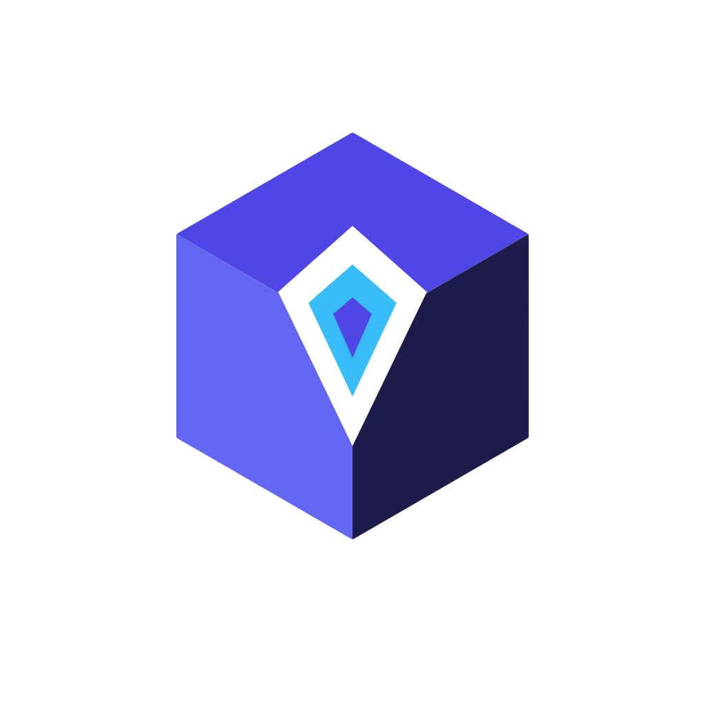

<div align="center">
  
  <h1>⚡ Lumina Electronics</h1>
  <p><strong>Plataforma E-Commerce de Tecnología & Hardware de Vanguardia</strong></p>

  [](https://react.dev/)
  [](https://www.typescriptlang.org/)
  [](https://tailwindcss.com/)
  [](https://vitejs.dev/)
  [](https://reactrouter.com/)
</div>

---

## 📌 Descripción del Proyecto

**Lumina Electronics** es una aplicación web e-commerce moderna desarrollada con React, TypeScript y Tailwind CSS. La plataforma simula una tienda de tecnología de alta gama con un catálogo dinámico alimentado por datos locales y APIs externas, gestión de estado global, persistencia en `localStorage`, diseño responsivo y un panel de administración protegido con control de acceso por roles.

---

## 🚀 Características Principales

### 🛍️ Experiencia del Cliente
* **Catálogo Dinámico:** Integración con API externa (DummyJSON) combinada con productos iniciales de alta fidelidad.
* **Filtros Avanzados en Tiempo Real:** Búsqueda por texto, filtrado por categorías, marcas, rango de precios, stock disponible, descuentos y calificación mínima.
* **Detalle de Producto Interactivo:** 
  * Galería de miniaturas inteligentes que se adaptan al tipo de producto seleccionado (Smartphones, Audio, Laptops, Wearables, etc.).
  * Selección de cantidad con validación de stock disponible.
  * Selector de acabados/colores y cálculo automático de cuotas y descuentos.
  * Recomendación de accesorios complementarios.
* **Lista de Deseos (Wishlist):** Guardado de favoritos con persistencia en `localStorage` y badge sincronizado en el Navbar.
* **Carrito de Compras:** Gestión de unidades añadidas, contador global en tiempo real y opción de vaciado rápido.
* **Página de Error 404 Personalizada:** Pantalla temática "Señal Perdida" con recomendaciones de productos alternativos.

### 🔐 Autenticación & Control de Roles
* **Registro de Usuarios:** Validación de contraseña segura (mínimo 8 caracteres, mayúscula y número) y restricción de dominio para cuentas administrativas.
* **Acceso por Roles:** Distinción estricta entre cuentas de compradores (`Cliente`) y el administrador de la tienda (`Admin`).
* **Rutas Protegidas:** Componente guardia `<RutaProtegida />` con React Router que expulsa a usuarios no autorizados o invitados que intenten acceder al panel `/admin`.

### 🛠️ Panel de Administración (`/admin`)
* **Métricas en Tiempo Real:** Total de productos en inventario, valor económico del catálogo, productos en bajo stock y artículos destacados.
* **Gestión de Productos (CRUD):** 
  * Tabla administrativa con vista previa, edición y eliminación.
  * **Modal de Creación y Edición (HU-12):** Validación completa de campos, autogeneración de ID único (`PRD-xxxx`), soporte para descuentos, marcas y categorías.
* **Gestión de Clientes y Usuarios (HU-13):** Tabla con buscador por nombre/email en tiempo real, visualización de roles, estados de cuenta y opción de eliminación.

---

## 🔑 Credenciales de Acceso (Modo Demostración)

Para acceder al **Panel de Administración**, dirígete a `/login` e ingresa con las siguientes credenciales preconfiguradas:

| Campo | Valor |
| :--- | :--- |
| **Email** | `admin@lumina.dev` |
| **Contraseña** | `Admin2026!` |
| **Rol asignado** | Administrador |

> *Nota: También puedes registrar un nuevo usuario comprador desde `/registro` para probar la experiencia de cliente estándar.*

---

## 🛠️ Tecnologías Utilizadas

* **Frontend:** React 19, TypeScript
* **Enrutamiento:** React Router DOM v7
* **Estilos:** Tailwind CSS v4 con variables CSS personalizadas
* **Empaquetador & Servidor:** Vite
* **Consumo de APIs:** Axios (DummyJSON Products API)
* **Iconografía:** Heroicons & SVG custom

---

## 💻 Instalación y Ejecución Local

Sigue estos pasos para clonar y correr el proyecto en tu máquina:

```bash
# 1. Clonar el repositorio
git clone https://github.com/tu-usuario/lumina-electronics.git

# 2. Entrar a la carpeta del proyecto
cd lumina-electronics

# 3. Instalar las dependencias
npm install
# o con pnpm:
# pnpm install

# 4. Iniciar el servidor de desarrollo
npm run dev

# 5. Abrir en el navegador
# http://localhost:5173
```

---

## 📦 Compilación para Producción

Para compilar el proyecto antes de desplegar en Vercel, Netlify o cualquier host estático:

```bash
npm run build
```

El build de producción se generará en la carpeta `dist/`.

---

## 👥 Equipo de Desarrollo

Proyecto desarrollado con dedicación y trabajo en equipo por:

* **Hector Herrera** — *Frontend Architect & UI Lead*
* **Guadalupe Andriani** — *Backend & DB Architect*
* **Daniel Barraza** — *FullStack & QA Lead*

---

## 📄 Licencia

Este proyecto fue desarrollado con fines educativos y de demostración técnica para el módulo de React en RollingCode School.